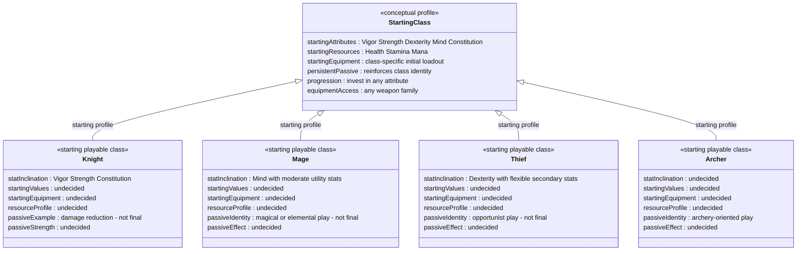
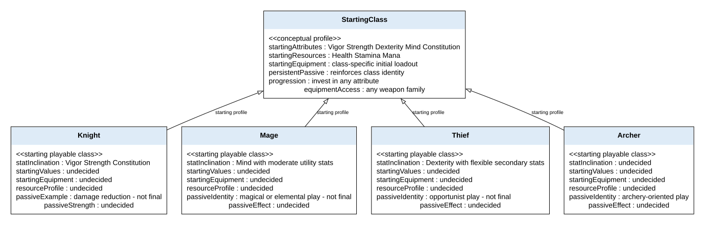

# Starting playable class diagram

> Epic: #29 · Story: #32 · Design task: #60

## Purpose and scope

Requirement (#60): "Create a class diagram for the game's combat system showing
combat classes, their attributes, and capabilites."

Figure 1 shows the four planned starting playable classes: Knight, Mage, Thief,
and Archer. Each provides starting attributes, resources, equipment, and a persistent
class passive. The player can subsequently invest in any attribute and equip any
weapon family. A class establishes a starting inclination, not a permanent build
restriction. Weapon and element choices coexist with this foundation.

This is a conceptual gameplay diagram. Its boxes are playable class profiles,
not implemented C# subclasses or a prescribed software inheritance hierarchy.
Exact values, equipment lists, and final passive effects remain open for team
review. The Knight damage-reduction passive is an illustrative example supplied
by the user, not a finalized balance rule.

*Figure 1 — Planned starting playable classes and their shared freedoms. Hollow
triangles mean each class is a kind of starting profile in this conceptual model;
they do not require C# inheritance. Each class retains its identity passive while
later attribute and equipment choices remain unrestricted by class.*

*Figure 1, exported view — The same profiles and relationships. Editable sources:
the Mermaid block above and the [DOT file](diagrams/combat-class-diagram.dot).*

## Class attributes and capabilities

| Class | Starting attribute inclination | Class identity and passive capability | Starting equipment and resources |
|---|---|---|---|
| Knight | Higher Vigor, Strength, and Constitution | Defensive identity. Damage reduction is an example passive; exact effect, conditions, and magnitude are undecided. | Class-specific equipment and Health/Stamina/Mana profile; exact loadout and values undecided. |
| Mage | Higher Mind with moderate utility stats | Magical/elemental identity. The brief suggests elemental/status builds, mana cycling, and projectile/spell volume as identity examples; a specific passive is undecided. | Class-specific equipment and Health/Stamina/Mana profile; exact loadout and values undecided. |
| Thief | Higher Dexterity with flexible secondary stats | Opportunist identity. The brief suggests crit/attack speed, poison/DoT, and dodge play as identity examples; a specific passive is undecided. | Class-specific equipment and Health/Stamina/Mana profile; exact loadout and values undecided. |
| Archer | Undecided; no attribute allocation has been selected. | Archery-oriented starting identity requested by the user; persistent passive effect, conditions, and magnitude are undecided. | Class-specific equipment and Health/Stamina/Mana profile; exact loadout and values undecided. |

Vigor, Strength, Dexterity, Mind, and Constitution are attributes. Health,
Stamina, and Mana are resources. These starting inclinations describe the design
brief's Knight/Mage/Thief profiles, not verified numeric differences in the current
prototype. Archer is added at the user's request; its specific starting profile
and passive are not defined by that brief. Archer retains access to every weapon
family, including non-bow weapons, under the shared class rules.

The user's clarified rule is that each starting class has a persistent passive
that makes it play more like its imagined identity. A Knight can still invest in
Mind and use magical equipment; its passive continues to provide its class
identity. This example introduces no new equipment restriction or passive formula.

## Planning alignment and implementation status

Design basis: the team Gameplay Systems & Mechanics Brief v0.2, section 4
(Classes, Passives, Attributes & Resources), section 6 (no weapon-family class
locks), and section 11 (final passives and movement abilities remain open), plus
the user's clarification that classes are flexible starting foundations with
persistent identity passives and the requested addition of Archer. Personal reference locations are kept outside this
shared repository.

The brief proposes choosing one of three starting passives per class. The user's
clarification establishes the importance of the resulting passive but does not
finalize that selection mechanism. This diagram represents the persistent
passive without inventing the three-option catalog.

Proposal Objective 1.1 (#32) also requires a distinct starting attribute/resource
profile and a class-specific traversal or utility capability for each class. The
brief's slam/hover/air-step examples are not final. Current traversal utilities
are weapon-based; assigning them to classes requires team alignment. A passive
alone is not claimed to satisfy that traversal/utility acceptance criterion.

The current prototype has a shared `AttributeSet` stub, shared combat components,
and weapon-based traversal. It does not define Knight/Mage/Thief/Archer starting
profiles or implement their persistent class passives. The diagram therefore
matches the clarified prototype plan, not completed playable-class code. Sword,
Bow, and Wand combat test loadouts are equipment test presets, not these classes.

## Review checklist

- [ ] Review the four-class roster: Knight, Mage, Thief, and Archer. #60's
      numeric minimum is unspecified; #32 requires at least three starting classes.
- [ ] Fill in each class's five starting attribute values, resource values, and
      initial equipment list.
- [ ] Choose each class's passive and define its conditions and values; confirm
      whether the brief's choice of one of three passives remains intended.
- [ ] Resolve class-specific traversal/utility requirements against the existing
      weapon-based traversal before claiming #32 acceptance.
- [ ] Confirm #60's parent issue, which is currently unspecified. The header
      records the relevant planned class responsibility, not an issue mutation.

Checked the roster, attribute inclinations, and open decisions against the team
brief and the user's clarification. Current-code claims were checked against
`Assets/Scripts/Combat/AttributeSet.cs`, `CombatTestLoadouts.cs`, and
`Assets/Movement/WeaponTraversal.cs` under `prototype/ProjectRogue`. This design
update does not report a new Unity runtime test or implementation of #32.
