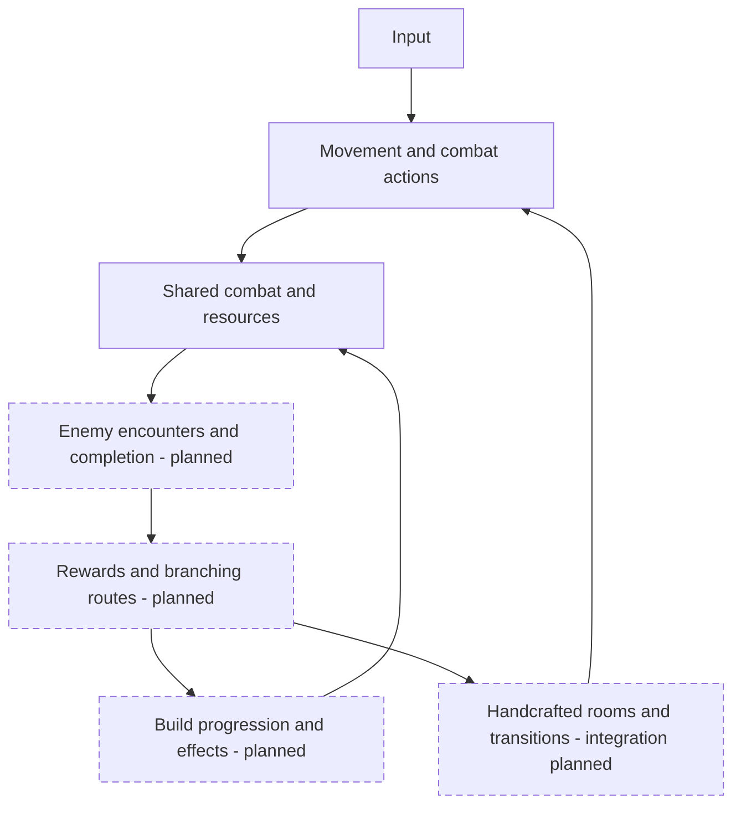
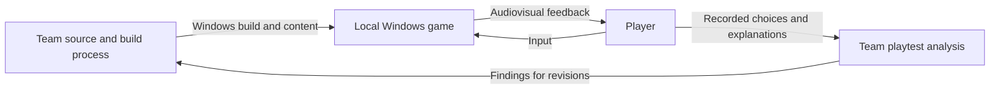

# Project Rogue — proposed system overview

> Task: #49 · Epics: #29, #30, #31 · Stories: #32–#41

Status: proposal draft for team review. These diagrams summarize responsibilities; they do not finalize APIs or certify an integrated game.

## Gameplay architecture

Movement and combat have prototype foundations in merged PRs #44 and #45. The remaining boxes represent proposed systems or integrations drawn from the gameplay brief and proposal objectives. Arrows show intended information flow, not existing method calls. Dashed boxes identify planned work; solid boxes identify prototype foundations.

*Figure 1 — Proposed gameplay responsibilities. Solid boxes have prototype foundations; dashed boxes require implementation or integration.*

## System context

The intended delivery is a local Windows game. The player supplies input and receives audiovisual feedback. The team builds and distributes the application and its content. Playtest observations inform revisions; no automatic telemetry service is implied. GitHub supports source review and artifact handling, rather than gameplay execution.

*Figure 2 — Intended Windows delivery and evaluation context. Feedback is recorded through the playtest procedure, not assumed to be collected automatically.*

## Evidence and boundaries

- `prototype/ProjectRogue/ProjectSettings/ProjectVersion.txt` identifies Unity 6000.3.25f1.
- `prototype/ProjectRogue/Packages/manifest.json` lists the Input System and Universal Render Pipeline.
- `PlayerCombat`, `ResourcePool`, and `CombatResolver` establish the combat foundation; they do not constitute the full progression and encounter loop.
- [Movement PR #44](https://github.com/austin2578/CPSC490-G18-ProStrats/pull/44) records traversal demonstrations. [Combat PR #45](https://github.com/austin2578/CPSC490-G18-ProStrats/pull/45) records separate combat demonstrations and limitations.
- The earlier design brief's fixed-class descriptions are superseded for this draft by the approved weapon-and-element direction. The proposal's earlier sections and issue criteria still require team reconciliation.
- Save-file format, detailed module APIs, controller support, final packaging, performance requirements, and balance formulas remain undecided.

The Mermaid blocks above are editable diagram sources. The accompanying SVG files are exported views used by proposal §4. Update both representations together when the reviewed design changes.
