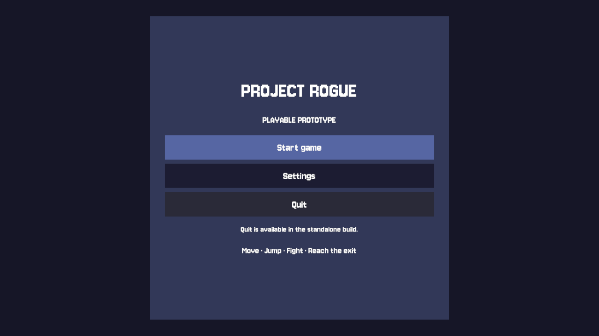

# Menu flow verification

> Epic: #30 · Stories: #36, #37 · Task: #79

## Implemented slice

TitleScreen loads the menu-enabled playable arena. The UI provides pause/resume,
Settings/Controls with opener-aware Back, quit confirmation, death and room
completion screens, and a fresh-scene retry. It follows the title/pause/settings/
results mockups from #76 and PR #78, with a direct-to-demo entry agreed with the
user. This does not implement inventory, route/reward UI or a three-Act run.

`MenuFlow` owns one persistent Canvas and EventSystem. Pause sets time scale to
zero, pauses audio and blocks combat/arena input. Scaled physics, cooldowns,
resource regeneration, enemy windups and projectile lifetimes stop. Resume waits
for held gameplay keys to release. Scene reload discards arena actors, transient
abilities and resources; the singleton prevents duplicate UI on return to Title.
The copied local arena was adapted to develop's combat API without importing the
unmerged boon/effect feature or duplicate movement classes. Enemy and room tuning
are temporary demonstration content, not acceptance of Objective 2.3.

## Repeatable live-Editor procedure

1. Use Unity 6000.3.25f1 and open `Assets/Scenes/TitleScreen.unity` alone.
2. Enter Play and wait for the title screen.
3. Run `Project Rogue → UI → Verify menu flow (Play mode)`.
4. Read the final report and inspect the Console. On failure, read the first
   failed assertion and reset Play mode before rerunning.

The verification code is `Assets/Editor/MenuFlowVerification.cs`. It sends
keyboard events through an isolated virtual keyboard and pointer-click events
through the UI EventSystem. Temporary input-focus settings and volume preferences
are restored in a finally block. It exercises real production movement, damage,
resources, enemies and a projectile, with forced lethal damage and room clearing
to reach result states consistently. It is an Editor verification tool, not an
NUnit suite or proof of Unity testing in CI.

## Recorded results — November 19, 2026

Live Unity Editor run: **36 checks passed**, including:

- Title focus, Tab navigation, keyboard submit, disabled Editor Quit.
- Settings Apply/persistence, discard on Back and opener focus restoration.
- Arena loading, movement, jump, dash and one player/UI/EventSystem instance.
- Pause stopping player/enemy movement, an actual projectile, game clock and
  regeneration; paused ability rejection without resource spending.
- Settings opened from Pause, Escape return, quit confirmation and Cancel.
- Held attack input blocked across Resume; the original player/projectile resume.
- Basic/active attacks, mana spending and enemy damage through shared combat.
- Death, fresh retry, room clear plus exit, another retry and no duplicated actors.
- Confirmed return to Title unloads the arena and restores simulation/audio pause.

The settings layout was rendered at actual **1280×720** and **1920×1080** Game-view
resolutions with no overflowing text. All seven menu panels were additionally
checked for text overflow at 1080p. Focus, hover, pressed and disabled colors are
configured on the uGUI Selectables. Screenshots are review aids; UI implementation
is generated at runtime from the serialized scene bootstrap.

Windows x64 / Mono build from the project without the temporary Pipeline tooling
package: **Succeeded, 0 errors, 0 warnings**. The executable launched and its game
window was observed. The native window-control tool could not attach; standalone
button interaction and Application.Quit were therefore not verified. The 36
interaction assertions above were run in the Unity Editor, not the standalone.

Repository harness on a clean source snapshot: **0 failures, 4 existing warnings**
(three goal specifications are not linked from proposal §4, and the Goal 3 spec
contains placeholders). GitHub-dependent gates were skipped locally and remain
for CI. `git diff --check` passed. Nothing in this report implies a green CI run
or teammate approval.

## Remaining human acceptance

Teammate review, acceptance against every issue criterion, usability/difficulty
assessment and CI results remain separate. The demo has no music/effects tracks;
the master volume value and persistence are verified, not an audible mix.
Keyboard and mouse are the intended controls; a controller was not tested.
Standalone interaction still needs a human smoke test. This report
does not close #79 or claim that the branch has been merged.
