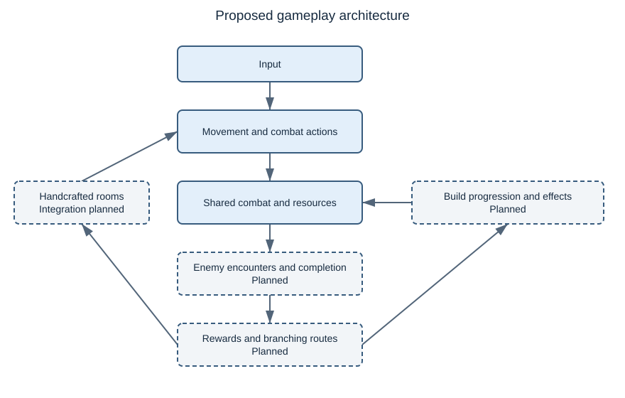
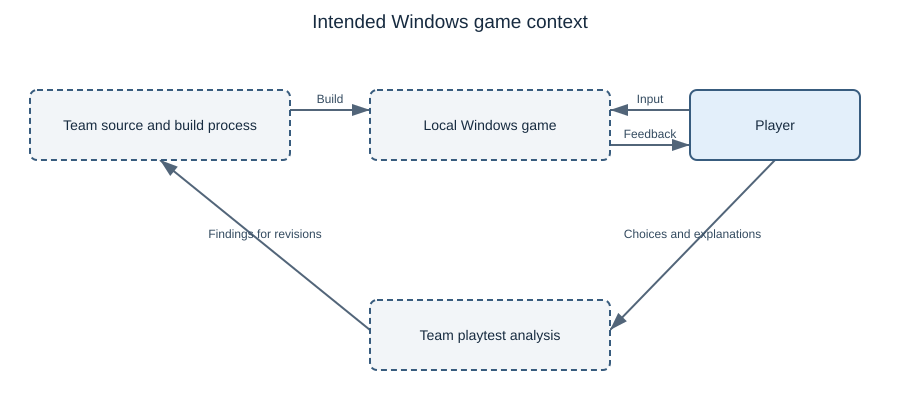

# Project Proposal — Project Rogue

**Department of Computer Science**  
**CPSC 490 Undergraduate Seminar in Computer Science — Proposal for Capstone Project**

**Group 18 — ProStrats (Procrastination Strategies)** · Sponsor: independent  
Authors: Monroe, Austin (austin2578), Truong, Brady (Ztaco10), Brodersen, Kimberly (Kmbroders), Armenta, Maximiliano (MaxArmenta-04), Bumatay, Rebekah (r1beka)  
Repository: https://github.com/austin2578/CPSC490-G18-ProStrats  
Date: 2026-10-11

---

## 0. Abstract
Project Rogue is a 2D platformer roguelite that explores how combat, equipment, and character builds work together to create different routes and how these decisions affect a run. Project Rogue draws mechanic and world building inspiration from other other games such as Dead Cells, Hades, Slay the Spire, and Salt and Sanctuary.
The project features flexible starting classes, run-specific attributes, boons, branching routes, and distinct weapon types with a goal of achieving character build variety and replayability through persistent progression each run. By combining structured randomness with unique encounters, Project Rogue seeks to provide varied runs while preserving previous combat, exploration, and platforming experience.
The primary goal of this porject is to develop a playable prototype and test how well these systmes can work together. The proposed systems / mechanics will be tested by playing the game ourselves to determine whether players will be able to understand different build options, make meaningful decisions, and adapt to new weapons and abilites that can be unlocked on different routes or playthroughs.

(add more once proposal finished)

## 1. Introduction

Roguelite games are built around repeated runs where the player faces changing challenges, rewards, and opportunities to develop a character. In an action-focused roguelite, these decisions happen alongside real-time combat, movement, and exploration, so both player skill and character-building choices can influence whether a run succeeds. Replayability is an important part of this type of game because each attempt should give the player a reason to make different choices instead of simply repeating the same sequence. Weapons, upgrades, routes, and temporary abilities can all contribute to this variety, but having many options does not automatically mean that those options create meaningful decisions.

One problem Project Rogue addresses is that character progression can become restrictive when a starting class strongly determines which equipment or abilities remain useful for the rest of a run. A player may technically have several choices available while still being encouraged to follow a narrow build because changing direction would make earlier investments ineffective. Weapon progression can become similarly predictable when a new weapon is mainly judged by whether its damage number is larger than the current weapon. These systems can reduce the value of experimentation and make later runs feel similar even when different rewards appear.

Level structure creates a separate problem for a replayable action game. Fully randomized environments can provide variety, but too much randomness can reduce the quality of deliberate platforming, combat spaces, and encounter pacing. Fully authored levels can provide carefully designed encounters, but repeated play can make the same route increasingly predictable. Project Rogue therefore proposes separating the organization of a run from the physical design of its rooms. A run can change through branching routes, encounter types, rewards, and connections while the individual combat, traversal, puzzle, and event spaces remain handcrafted.

Project Rogue is a 2D action roguelite platformer designed around flexible character building, weapon-driven combat, and branching runs. Starting classes establish a player's initial direction without permanently restricting later weapon choices. During a run, players can develop a build through attributes, boons, weapon-family progression, skills, and randomized weapon properties. The active weapon can also be replaced, allowing a new weapon to create a strategic decision instead of functioning only as a direct upgrade. Changing weapons may encourage the player to reconsider attribute investment, skill choices, or which future rewards and routes are most useful.

The project is not based on the claim that any one of these mechanics is completely new. Classes, randomized rewards, branching routes, persistent progression, and weapon upgrades already appear throughout related games. The intended difference is how Project Rogue combines these systems so that choices in one part of a run can affect later decisions. A weapon can influence which attributes are valuable, upgrades can change how later rewards are evaluated, and route selection can determine which opportunities become available. The project will develop and test a playable prototype to determine whether these interacting systems can remain understandable while still giving players enough flexibility to create different builds and adapt during repeated runs.

### 1.1 Related Work
Action roguelites, roguelike deckbuilders, and action RPGs provide relevant precedents for Project Rogue through their approaches to combat and character development. The central design question is how combat, equipment, character identity, and route selection can produce meaningful decisions within a run. This survey compares Dead Cells, Hades, Salt and Sanctuary, and Slay the Spire along those dimensions.
The comparison uses developer descriptions rather than a controlled gameplay study; the strengths and limitations below are design interpretations relative to this project's goals, not measured judgments of game quality.
Dead Cells is the closest reference for the proposed moment-to-moment gameplay. Motion Twin describes it as a 2D action-platformer with pattern-based enemies, distinctive weapons and spells, nonlinear paths, and hidden passages [1]. These features connect combat execution with exploration: selecting a route changes the spaces and challenges the player encounters, while movement and enemy recognition determine whether the player survives.
This is a useful precedent for Project Rogue's combat rooms, traversal challenges, and secrets. However, the described approach does not by itself establish the proposed relationship between freely chosen attributes and persistent investments within a run's weapon-family skill trees. Project Rogue intends to make that relationship explicit, so replacing a weapon involves considering its moveset, scaling, and compatibility with previous investments rather than evaluating damage alone.
Hades provides a complementary reference for character builds. Supergiant Games describes weapons and selectable Olympian boons as sources of build variety, alongside permanent improvements available through the Mirror of Night [2]. Its relevance is the interaction between action combat and choices that modify the player's abilities. Project Rogue similarly proposes boons that affect attacks, statuses, and resources.
Its intended emphasis is on changing build direction during a run through weapon replacement, attribute redistribution, and weapon-family Mastery. This comparison does not imply that Hades lacks build depth; it identifies the additional progression structure that Project Rogue proposes to investigate. Supporting more opportunities to reconsider a build also creates a cost: the player must understand more dependencies before judging whether a new item is useful.
Salt and Sanctuary provides a relevant example of combining 2D action combat with RPG character customization. Ska Studios describes a system of discoverable, craftable, and upgradeable equipment within an interconnected world containing platforming challenges, secrets, and hidden shortcuts [3]. These features make it a useful reference for Project Rogue's relationship between equipment choices, combat, and room exploration.
The principal distinction is progression structure: Salt and Sanctuary emphasizes exploration of a connected world, whereas Project Rogue proposes branching routes through handcrafted encounters across three Acts. Project Rogue also intends to make weapon replacement a recurring strategic decision through run-local attributes, weapon-family Mastery, and respec opportunities.
This combination would require careful balancing so that changing weapons remains viable without making earlier investments feel meaningless.
Slay the Spire is relevant to strategic planning even though it centers on card combat rather than action-platforming. Mega Crit describes a changing layout, choices between safer and riskier paths, and interactions between cards and relics [4]. These systems make adaptation part of progression: the value of a reward depends on how it works with the current deck, while a route affects which opportunities become available.
Project Rogue applies a similar relationship to weapons, boons, and encounter selection. Its proposed branching map would lead to physical doors and handcrafted rooms, where players must execute the chosen strategy through movement and combat. Translating planning into real-time play adds a challenge absent from a purely card-based comparison: build information must remain understandable without disrupting the pace of combat.

| Existing approach | What it does | Pros relative to project goals | Cons or tradeoffs relative to project goals | Why Project Rogue differs |
|---|---|---|---|---|
| Dead Cells [1] | Combines 2D combat, distinctive equipment, nonlinear routes, and secrets. | Closely matches the desired connection between movement, combat, and exploration. | Does not serve as a direct specification for the proposed attribute and weapon-family Mastery relationship. | Proposes one active weapon with run-local family skill investments and attribute-based build changes. |
| Hades [2] | Combines action combat, weapons, boon choices, and permanent upgrades. | Shows how ability modifiers can support varied combat builds across repeated attempts. | Adopting boon choices alone would leave the project's respec and Mastery systems undefined. | Proposes coordinated changes to weapons, attributes, and family skill trees during a run. |
| Salt and Sanctuary [3] | Combines 2D action combat with customizable equipment, crafting, upgrades, and an interconnected world. | Connects character customization with combat, platforming, secrets, and exploration. | Its interconnected campaign structure provides a different progression model from the proposed branching, run-based encounters. | Project Rogue proposes run-local attributes and weapon-family Mastery, with replaceable weapons and branching routes through handcrafted rooms. |
| Slay the Spire [4] | Combines changing routes with card selection and relic interactions. | Links reward evaluation and risk management to the current build. | Card-based combat does not directly address movement, timing, or action readability. | Couples branching route decisions with handcrafted action, puzzle, and traversal rooms. |

Together, these works establish that equipment variety, temporary build modifiers, persistent progression, and strategic routing are existing approaches rather than new inventions. Project Rogue's proposed contribution is their particular combination: flexible starting classes, a replaceable active weapon, separate attribute and Mastery investments, and a branching route through authored encounters.
For example, a useful Staff drop could encourage a Knight to reconsider attributes and seek a respec service, making a combat reward influence the next route choice. The value of this combination remains a hypothesis. Prototyping and playtesting should determine whether players can understand these interactions, recognize viable build changes, and find those decisions worthwhile.
The gameplay design brief supplies this intended direction; it does not establish that the proposed systems have already been implemented or validated.

*Draft source entries for eventual integration into §8, numbered in order of first citation. These sources were consulted while preparing this draft; the team should read them before submission. They are kept here temporarily so this edit remains limited to §1.1.*

[1] Motion Twin. “Dead Cells.” Official game website. https://dead-cells.com/. Accessed October 2, 2026.  
[2] Supergiant Games. “Hades.” Developer-published game description on Steam, “About This Game.” https://store.steampowered.com/app/1145360/Hades/. Accessed October 2, 2026.

[3] Ska Studios. “Salt and Sanctuary.” Official game website. https://ska-studios.com/games/salt-and-sanctuary/. Accessed October 2, 2026.

[4] Mega Crit. “Slay the Spire.” Developer-published game description on Steam, “About This Game.” https://store.steampowered.com/app/646570/Slay_the_Spire/. Accessed October 2, 2026.

### 1.2 Problem Statements

P1. Build variety in roguelites can collapse when class choice locks players into a narrow set of options or when a few weapon builds dominate, which weakens replayability.  
P2. Fully random level generation tends to lose the quality of designed encounters, while fully authored levels lose variety; a run needs structured randomness that preserves both.  
P3. Weapon progression that relies on a single mechanism becomes predictable, so progression needs several interacting layers that remain understandable and balanceable.

**Every problem here must connect to the goals and objectives in §2, and
every goal in §2 must trace back to a problem here.** A goal with no problem
behind it is scope you invented; a problem with no goal is a problem you are
not actually solving. Check both directions before you submit — this mapping
is what the final project report is graded against.

| Problem | Addressed by |
|---|---|
| P1 Build Variety and class lock-in | Goal 1 - Flexible character progression [[epic:#29]](https://github.com/austin2578/CPSC490-G18-ProStrats/issues/29); Goal 2 - Action gameplay [[epic:#30]](https://github.com/austin2578/CPSC490-G18-ProStrats/issues/30) |
| P2 Structured randomness versus authored quality | Goal 3 - Replayable run structure [[epic:#31]](https://github.com/austin2578/CPSC490-G18-ProStrats/issues/31) |
| P3 Predictable weapon progression | Goal 1 - Flexible character progression [[epic:#29]](https://github.com/austin2578/CPSC490-G18-ProStrats/issues/29); Goal 2 - Action gameplay [[epic:#30]](https://github.com/austin2578/CPSC490-G18-ProStrats/issues/30) |

## 2. Goals and Objectives

**Goal 1: Flexible character progression** [[epic:#29]](https://github.com/austin2578/CPSC490-G18-ProStrats/issues/29)

Objective 1.1: Classes - Implement at least three starting classes with distinct starting attribute and resource profiles and one class-specific traversal or utility capability each, while allowing every class to equip any weapon family. [[story:#32]](https://github.com/austin2578/CPSC490-G18-ProStrats/issues/32)

Objective 1.2: Attributes/resources/respec - Implement five primary attributes (Vigor, Strength, Dexterity, Mind, and Constitution), Health, Stamina, and Mana resources, run-local leveling that awards three Attribute Points per level, and a respec process that returns and allows reassignment of invested Attribute Points. [[story:#33]](https://github.com/austin2578/CPSC490-G18-ProStrats/issues/33)

Objective 1.3: Weapons/Mastery/affixes/skills - Implement a weapon progression system that supports one active weapon at a time, weapon replacement during a run, S/A/B/C/D/E attribute scaling, weapon-family Mastery retained across same-family weapon replacements, randomized affixes, and up to three equipped active weapon skills. [[story:#34]](https://github.com/austin2578/CPSC490-G18-ProStrats/issues/34)

Objective 1.4: Boons/status/build interactions - Implement a shared boon, effect, and status system that can modify attacks, resources, and status effects, demonstrate at least four distinct build interactions, and track effect sources and proc depth to prevent uncontrolled recursive effect loops. [[story:#35]](https://github.com/austin2578/CPSC490-G18-ProStrats/issues/35)

**Goal 2: Action gameplay** [[epic:#30]](https://github.com/austin2578/CPSC490-G18-ProStrats/issues/30)

Objective 2.1: Movement/traversal - Implement horizontal movement, jumping, gravity and ground detection, and class-specific traversal utilities, and demonstrate these mechanics in at least one handcrafted traversal room that the player can complete from entrance to exit. [[story:#36]](https://github.com/austin2578/CPSC490-G18-ProStrats/issues/36)

Objective 2.2: Combat/damage/abilities - Implement a shared combat pipeline in which basic attacks and active abilities apply damage scaling and resource costs, allowing the player to damage and defeat a target using at least one basic attack and one active ability. [[story:#37]](https://github.com/austin2578/CPSC490-G18-ProStrats/issues/37)

Objective 2.3: Enemies/encounters - Implement at least three enemy encounter configurations in which enemies can engage the player, attack through the shared combat systems, take damage, die, and trigger encounter completion and rewards. [[story:#38]](https://github.com/austin2578/CPSC490-G18-ProStrats/issues/38)

**Goal 3: Replayable run structure** [[epic:#31]](https://github.com/austin2578/CPSC490-G18-ProStrats/issues/31)

Objective 3.1: Branching three-Act map + handcrafted rooms - Implement a branching three-Act route graph with at least two route choices in each Act, where selected nodes load handcrafted rooms and progression moves forward without fast-travel backtracking. [[story:#39]](https://github.com/austin2578/CPSC490-G18-ProStrats/issues/39)

Objective 3.2: Node/reward/run progression - Implement at least four node or reward types and run-local tracking for Gold, XP and Attribute Points, and Mastery, with completed nodes granting rewards that can affect later build or route decisions. [[story:#40]](https://github.com/austin2578/CPSC490-G18-ProStrats/issues/40)

Objective 3.3: Playtest build variety/decision-making - Conduct at least five playtest sessions that record class, weapon, route, and build choices, then summarize whether testers produced distinct builds and changed decisions in response to rewards or route options. [[story:#41]](https://github.com/austin2578/CPSC490-G18-ProStrats/issues/41)

## 3. Proposed Approaches

Project Rogue will investigate build variety by allowing players to begin with a weapon and an element, then adapt their build as rewards and route choices become available. Weapons supply active combat and utility abilities, while elements supply passive effects. Attributes, weapon-family Mastery, affixes, and boons will provide further ways to develop the build during a run. This approach addresses class lock-in by making starting choices a foundation for experimentation. Exact effects, ability values, and balance formulas will be refined through testing. The earlier class-based wording in §2 still requires team alignment with the approved weapon-and-element direction.

To combine replayability with deliberate encounter design, the project will use branching routes across three Acts connected to handcrafted rooms. Fully procedural terrain could provide more layouts, but would make platforming quality and encounter pacing harder to control. A single fixed route would preserve authored encounters but offer fewer routing decisions. A changing route structure with authored rooms allows the team to investigate both strategic choices and moment-to-moment play. Mandatory traversal paths will remain accessible to supported starting combinations; optional paths can reward weapon utility and exploration.

Combat, resources, and build effects will use shared rules so weapons and encounters can interact consistently. The existing combat pipeline provides a foundation for applying ability costs, cooldowns, scaling, and damage. Planned progression and effect systems will extend it, including effect-source and proc-depth tracking to prevent uncontrolled recursive triggers. Shared rules should make interactions easier to verify than separate formulas for each weapon. The implementation environment and proposed system boundaries are described in §4.

Development will proceed through small, testable increments: establish movement and combat, integrate progression and enemy encounters, then connect rooms, rewards, and routing. Individual mechanics will be checked before evaluating the combined gameplay loop. Once the necessary systems are available, at least five playtest sessions will record starting weapon and element, rewards, build changes, route choices, and the player's reasons. These observations will support conclusions about clarity and decision-making within the tested prototype; a small study will not establish long-term balance or replayability.

## 4. Required Environment, Resources, and Planned Activities

### Development environment and resources

Project Rogue uses C# and Unity 6000.3.25f1. The shared project, `prototype/ProjectRogue/`, uses the Universal 2D foundation, Universal Render Pipeline, Unity Input System, and 2D physics. Scenes, prefabs, scripts, project settings, and `.meta` files are versioned together; generated caches such as `Library` and `Temp` are excluded. The target deliverable is a downloadable Windows game. Developers need a computer able to run the selected Editor, a C# editor, Git, and a Windows environment for standalone-build testing. Minimum player hardware requirements will be established through build testing. Keyboard input exists in the prototype; final bindings, controller support, and archive-versus-installer packaging remain team decisions.

The team needs skills in C# scripting, 2D collision and physics, input handling, scene and prefab composition, interface design, balancing, and test documentation. Content resources include sprites, room layouts, animation, and audio. Placeholder content may support early development, with licensing and credits retained for distributed assets. The current foundation does not demonstrate a need for a server or DBMS; any later service or storage requirement must follow an approved feature.

GitHub hosts the source, issues, pull requests, and Sprint Board. The [development plan](../docs/development-plan.md) records team responsibilities, and the [Git workflow](../docs/git-workflow.md) defines feature work into `develop` and reviewed releases into `main`. Contributions identify their issue, verification evidence, and AI assistance, receive non-author review, and pass applicable checks. The repository harness checks repository and documentation consistency. Current CI detects Node/Python prototype projects; it does not compile or playtest Unity. Editor checks and Windows build tests therefore require separate evidence.

### Proposed system structure

Figure 1 summarizes the intended gameplay responsibilities. Movement and combat have separate prototype foundations. Progression, effects, encounters, and routing require further implementation or integration. These are conceptual responsibilities, not a finalized class hierarchy or evidence that the full run already works.

*Figure 1 — Proposed gameplay architecture. Dashed boxes identify planned systems or integrations.*

Figure 2 shows the intended Windows game in context. Players interact with the local application, developers supply tested builds and content, and playtest observations return to the team's evaluation process. GitHub supports development; gameplay is not shown depending on a live GitHub connection.

*Figure 2 — Intended system context for the downloadable Windows game and its evaluation.*

The [system overview](../docs/design/system-overview.md) contains editable diagram sources, exported views, evidence, and limitations. Save-file format, detailed progression interfaces, and final effect formulas remain design work.

### Specification and design documents

| Document | Kind | Covers | Status |
|---|---|---|---|
| [System overview](../docs/design/system-overview.md) | Design draft | Progression, action gameplay, and run structure from §2 | Proposed architecture and context views for team review |
| [Development plan](../docs/development-plan.md) | Working agreement | Responsibilities, workflow, and risks | Existing; risk register needs revision |
| [Sprint 1 review](../docs/sprint-reviews/sprint-1.md) | Progress evidence | Completed increments, limitations, and carry-over | Existing; carry-over details require confirmation |

The course example specification and design are reference material, not Project Rogue specifications. Feature specifications must define acceptance checks, dependencies, and scope before dependent implementation. The planned `docs/testing/playtest-protocol.md` will contain consistent tester instructions, recording fields, and an analysis plan. It is not yet available in this checkout and is tracked by [[task:#48]](https://github.com/austin2578/CPSC490-G18-ProStrats/issues/48).

### Planned activities — the work items

The table includes planned and completed work for Sprints 1–3. **Closed / completed** identifies issues closed as completed in GitHub; **Closed / retired** identifies duplicate tracking that was retired. These labels record issue status rather than a new acceptance decision. Movement and combat are shown in Sprint 1 to preserve the team's reported completion history, although their current GitHub milestones are Sprint 2. The Sprint 1 review follow-up (#47) is listed in Sprint 2 according to its milestone.

| Sprint | Issue | Planned activity | Owner | Status |
|---|---|---|---|---|
| Sprint 1 | [[task:#2]](https://github.com/austin2578/CPSC490-G18-ProStrats/issues/2) | Set up the project README | Austin | **Closed / completed** |
| Sprint 1 | [[task:#5]](https://github.com/austin2578/CPSC490-G18-ProStrats/issues/5) | Early Related Work writing; overlaps #8 | Brady | **Closed / completed** |
| Sprint 1 | [[task:#6]](https://github.com/austin2578/CPSC490-G18-ProStrats/issues/6) | Write the problem statements | Max | **Closed / completed** |
| Sprint 1 | [[task:#7]](https://github.com/austin2578/CPSC490-G18-ProStrats/issues/7) | Write the Abstract and development plan | Rebekah | **Closed / completed** |
| Sprint 1 | [[task:#8]](https://github.com/austin2578/CPSC490-G18-ProStrats/issues/8) | Compare related games and document sources | Brady | **Closed / completed** |
| Sprint 1 | [[task:#9]](https://github.com/austin2578/CPSC490-G18-ProStrats/issues/9) | Prepare cover information and Introduction | Austin | **Closed / completed** |
| Sprint 1 | [[task:#15]](https://github.com/austin2578/CPSC490-G18-ProStrats/issues/15) | Establish the shared Unity project | Austin | **Closed / completed** |
| Sprint 1 | [[task:#17]](https://github.com/austin2578/CPSC490-G18-ProStrats/issues/17) | Retire duplicate prototype-goal tracking | Austin | **Closed / retired** |
| Sprint 1 | [[task:#18]](https://github.com/austin2578/CPSC490-G18-ProStrats/issues/18) | Track shared Unity environment requirements; overlaps #15 | Austin | **Closed / completed** |
| Sprint 1 | [[task:#19]](https://github.com/austin2578/CPSC490-G18-ProStrats/issues/19) | Retire duplicate proposal-goal tracking | Austin | **Closed / retired** |
| Sprint 1 | [[task:#20]](https://github.com/austin2578/CPSC490-G18-ProStrats/issues/20) | Document proposal motivation and initial content | Austin | **Closed / completed** |
| Sprint 1 | [[task:#28]](https://github.com/austin2578/CPSC490-G18-ProStrats/issues/28) | Write goals and measurable objectives | Austin | **Closed / completed** |
| Sprint 1 | [#36](https://github.com/austin2578/CPSC490-G18-ProStrats/issues/36) | Objective 2.1 — Implement movement, traversal utilities, and a handcrafted traversal room | Brady | **Closed / completed** |
| Sprint 1 | [#37](https://github.com/austin2578/CPSC490-G18-ProStrats/issues/37) | Objective 2.2 — Implement shared combat, ability costs, damage scaling, and target defeat | Max | **Closed / completed** |
| Sprint 2 | [#32](https://github.com/austin2578/CPSC490-G18-ProStrats/issues/32) | Objective 1.1 — Define and implement starting playstyles; align class wording with the approved weapon-and-element direction | Austin | **Open / planned** |
| Sprint 2 | [#33](https://github.com/austin2578/CPSC490-G18-ProStrats/issues/33) | Objective 1.2 — Implement five attributes, Health/Stamina/Mana, leveling, and respec | Austin | **Open / planned** |
| Sprint 2 | [#34](https://github.com/austin2578/CPSC490-G18-ProStrats/issues/34) | Objective 1.3 — Implement weapon replacement, scaling grades, Mastery, affixes, and up to three active skills | Max | **Open / planned** |
| Sprint 2 | [#35](https://github.com/austin2578/CPSC490-G18-ProStrats/issues/35) | Objective 1.4 — Implement boons, effects, statuses, at least four build interactions, and controlled proc behavior | Rebekah | **Open / planned** |
| Sprint 2 | [#38](https://github.com/austin2578/CPSC490-G18-ProStrats/issues/38) | Objective 2.3 — Implement at least three enemy encounter configurations, attacks, defeat, completion, and rewards | Kim | **Open / planned** |
| Sprint 2 | [[task:#47]](https://github.com/austin2578/CPSC490-G18-ProStrats/issues/47) | Complete the Sprint 1 review and document evaluation follow-up | Brady | **Closed / completed** |
| Sprint 2 | [[task:#48]](https://github.com/austin2578/CPSC490-G18-ProStrats/issues/48) | Prepare the Objective 3.3 playtest procedure, evidence sheet, and analysis plan | Brady | **Open / planned** |
| Sprint 2 | [[task:#49]](https://github.com/austin2578/CPSC490-G18-ProStrats/issues/49) | Draft proposal sections 3–5, system diagrams, and the Sprint 1–3 activity plan | Brady | **Open / planned** |
| Sprint 3 | [#39](https://github.com/austin2578/CPSC490-G18-ProStrats/issues/39) | Objective 3.1 — Build three-Act branching routes, at least two route choices per Act, and handcrafted-room progression | Kim | **Open / planned** |
| Sprint 3 | [#40](https://github.com/austin2578/CPSC490-G18-ProStrats/issues/40) | Objective 3.2 — Implement at least four node/reward types and track Gold, XP, Attribute Points, and Mastery | Rebekah | **Open / planned** |
| Sprint 3 | [#41](https://github.com/austin2578/CPSC490-G18-ProStrats/issues/41) | Objective 3.3 — Conduct at least five playtest sessions and analyze build variety and changed decisions | Brady | **Open / planned** |

Goals 1 and 2 group the Sprint 2 work, and Goal 3 groups the Sprint 3 work. Their epics are defined in §2 and are not additional tasks or additional story points. Objective rows summarize the activities needed to deliver those objectives; their acceptance criteria remain in §2 and the linked issues. Starting-playstyle requirements still need alignment with the approved weapon-and-element direction.

The sprint table excludes records with no assigned sprint: [#13](https://github.com/austin2578/CPSC490-G18-ProStrats/issues/13) (undefined test record), [#26](https://github.com/austin2578/CPSC490-G18-ProStrats/issues/26) (course-file updates), and instructor records [#3](https://github.com/austin2578/CPSC490-G18-ProStrats/issues/3), [#22](https://github.com/austin2578/CPSC490-G18-ProStrats/issues/22), [#24](https://github.com/austin2578/CPSC490-G18-ProStrats/issues/24), and [#43](https://github.com/austin2578/CPSC490-G18-ProStrats/issues/43). Their classification, owners, and any remaining work need board reconciliation. These sprint allocations do not replace §6's CPSC 491 implementation timeline.

Verification will cover movement and collision, ability costs and cooldowns, damage and defeat, progression changes, encounter completion, rewards, and route transitions as systems become available. Playtests will use a recorded build version and consistent tasks. The team will compare choices and explanations across at least five sessions once build and route decisions are functional. Earlier movement and combat checks are component tests rather than the completed build-variety study.

## 5. Project Outcomes

The intended outcome is a downloadable Windows version of Project Rogue that supports weapon-and-element builds through action combat, progression, rewards, and branching routes through handcrafted rooms. The finished implementation will be accompanied by the source repository, build and run instructions, player-facing control and gameplay instructions, design and specification documents, and the final project report. Playtest records and analysis will describe whether testers formed different builds and changed decisions in response to rewards or route options, including limitations and unresolved issues. CPSC 490 establishes the proposal and prototype foundation; the broader implementation is planned for CPSC 491. Windows packaging and minimum hardware requirements will be confirmed through standalone-build testing.

The current prototype provides separate movement/traversal and combat demonstrations in `develop`, documented by merged PRs [#44](https://github.com/austin2578/CPSC490-G18-ProStrats/pull/44) and [#45](https://github.com/austin2578/CPSC490-G18-ProStrats/pull/45). To inspect them, clone the repository, select an up-to-date `develop` checkout containing those changes, add `prototype/ProjectRogue` to Unity Hub, and open it in Unity 6000.3.25f1. Open `Assets/Scenes/TraversalRoom.unity` and enter Play mode for traversal, or `Assets/Scenes/Test_Combat.unity` for combat; combat uses J for a basic attack, K for an active ability, and M to cycle test loadouts. The merged PRs record movement, traversal, resource, cooldown, scaling, and target-defeat checks. These foundations do not yet demonstrate a complete end-to-end run: attribute scaffolding, unfinished element effects, projectile-wall behavior, and integration with encounters, progression, and routing remain work. A tested standalone Windows release and the full playtest study are intended deliverables rather than established results of these Editor demonstrations.

## 6. Project Timeline

> Identifies tasks (project objectives) to be performed, milestones to be
> met, and the estimated number of hours for each task.

〈**This is the plan for CPSC 491 next semester — the implementation timeline,
not this semester's proposal work.** Identify the tasks (your objectives from
§2), the milestones, and the estimated hours for each, in the order they will
be built. State the assumptions it rests on (sponsor availability, data
access, hardware).〉

| Task (objective) | Milestone | Owner | Est. hours | Spring phase |
|---|---|---|---|---|
| 〈…〉 | 〈…〉 | 〈…〉 | 〈…〉 | 〈…〉 |
| 〈…〉 | 〈…〉 | 〈…〉 | 〈…〉 | 〈…〉 |

〈Do **not** put this fall's four proposal sprints here — those live on the
project board and in `docs/sprint-reviews/`. This section answers "how does
the system actually get built next semester?"〉

## 7. AI Usage

> Per the course AI policy (see the syllabus, Use of AI Tools), disclose the
> AI tools used in preparing this proposal and the prototype: which tools,
> for what tasks (e.g., code generation, test writing, debugging,
> diagramming), and approximately what fraction of each artifact was
> AI-assisted.
>
> Reminder: the prose of this proposal must be your own writing. You remain
> fully responsible for the correctness of all AI-assisted work, including
> the prototype code.

〈Your disclosure. Naming the tool is not disclosure — name what it drafted,
what fraction of each artifact was AI-assisted, and how you verified it.〉

## 8. References

> [1] Burges, C. J. C. Tutorial on Support Vector Machines for Pattern
> Recognition. Kluwer Academic Publishers, 1998.
> [2] Chen, P., Fan, R., and Lin, C. A study on SMO-type decomposition
> methods for support vector machines. IEEE Transactions on Neural Networks,
> 2006.
> [3] For Wikipedia, specify the URL here
> [4] For a web source, specify the URL here plus date accessed

〈Number references in the order first cited and cite them in the text as
[1], [2]. Every entry must be a source a team member has actually read and
can produce on request.〉
